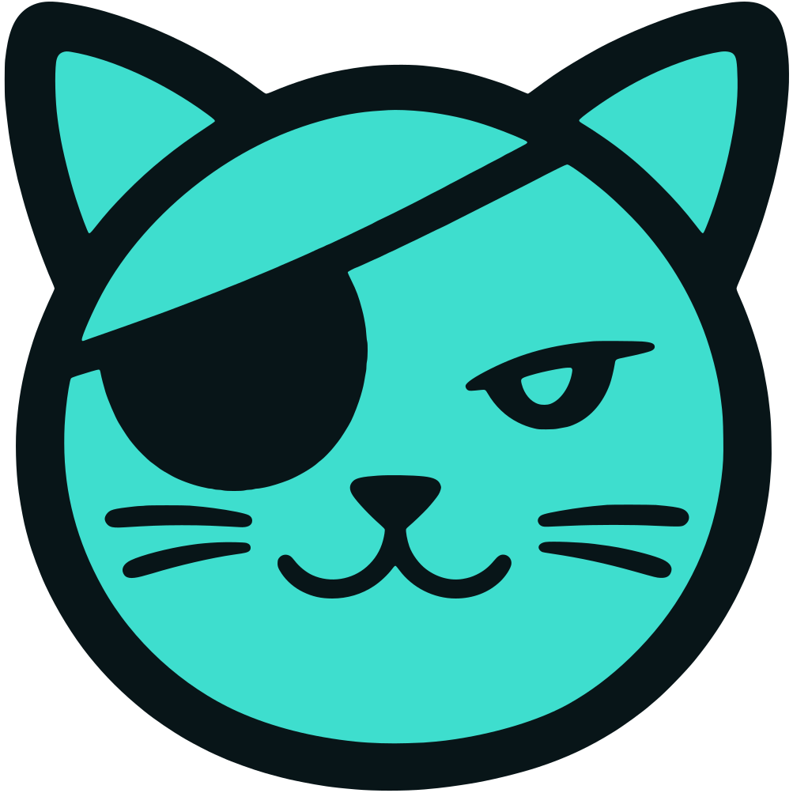

<p align="center">
  
</p>

# NaviPlayer

A dark, album-art-first web player for your
[Navidrome](https://www.navidrome.org/) music server.

You run NaviPlayer next to your Navidrome; the people you share your music with
open it in a browser and sign in with their Navidrome username and password.
Music, accounts, playlists, favourites and play counts all stay in Navidrome,
and Navidrome's permissions apply. NaviPlayer is only the player.

> NaviPlayer is an independent project, inspired by
> [Tonearm](https://github.com/j4ckxyz/navidrome-client-web). It is not an
> official Navidrome project and is not affiliated with or endorsed by
> Navidrome.

**Contents:** [Features](#features) · [Quick start](#quick-start) ·
[Configuration](#configuration) · [Deployment](#deployment) ·
[Optional features](#optional-features) · [Updating](#updating) ·
[Troubleshooting](#troubleshooting) ·
[Security and privacy](#security-and-privacy) ·
[Known limitations](#known-limitations) · [Development](#development)

## Features

**Listening**

- Browse artists, albums, genres, recently added and most played; typo-tolerant
  search and a command palette (<kbd>Ctrl</kbd>/<kbd>⌘</kbd>+<kbd>K</kbd>)
- A queue with drag-to-reorder, shuffle and repeat; it survives a page reload
- Gapless playback, crossfade, volume levelling (ReplayGain) and a 10-band
  equaliser
- A full-screen player with colours taken from the album art
- Synced lyrics, from your server or, if you turn it on, from
  [LRCLIB](https://lrclib.net)
- **Artist radio:** a never-ending station for one artist that mixes their
  best-known songs with songs by similar artists
- **Infinite radio:** when the queue runs out, it carries on with similar tracks
- **Surprise Me:** one random song and a queue of tracks that go with it
- Media keys and lock-screen controls, sleep timer, listening history

**Your library**

- Favourites, and playlists you can create, rename, reorder, make public and
  give a cover
- Download tracks, albums and playlists, original or converted
- A **Stats** page and a yearly **Recap** of your listening
- Admins can upload music from the browser: files, folders or a ZIP

**Making it yours**

- Rename the app for your household or friends (`VITE_APP_NAME`)
- English and Portuguese (Portugal), picked from the browser's language or set
  in Settings
- Rebindable keyboard shortcuts, layout density and cover size; settings
  export and import
- Installable as an app on phones and desktops (PWA)

There is one colour scheme, dark with a teal accent, and no theme picker.

## Quick start

You need [Docker](https://docs.docker.com/get-docker/) and a running Navidrome.

```bash
git clone <this repository> navi-player && cd navi-player
cp .env.example .env
```

Edit `.env` and set the address of your Navidrome **as the NaviPlayer container
will see it**:

```bash
VITE_NAVIDROME_URL=http://192.168.1.50:4533
```

Then start it:

```bash
docker compose up -d --build
```

Open <http://localhost:8680> and sign in with a Navidrome account.

Don't have Navidrome yet? `docker compose -f docker-compose.full.yml up -d` runs
Navidrome and NaviPlayer together. Edit `MUSIC_HOST_DIR` in that file to point
at your music first.

Before letting anyone in from outside your home network, put HTTPS in front of
it. See the [HTTPS checklist](#https-checklist).

## Configuration

Everything is set with environment variables, in `.env` or the compose file.
Only `VITE_NAVIDROME_URL` is required.

| Variable                                  | Default      | What it does                                                                                                       |
| ----------------------------------------- | ------------ | ------------------------------------------------------------------------------------------------------------------ |
| `VITE_NAVIDROME_URL`                      | —            | **Required.** Your Navidrome's address. Include its base path if it has one, e.g. `https://example.com/navidrome`. |
| `VITE_APP_NAME`                           | `NaviPlayer` | The name shown in the sidebar, login screen, browser tab and installed app. Up to 40 characters.                   |
| `UPLOAD_MAX_MB`                           | `2048`       | Largest upload accepted (one file or one ZIP), in MB.                                                              |
| `MUSIC_DIR`                               | off          | Turns on admin uploads into this folder. See [Uploads](#uploads).                                                  |
| `NAVIDROME_OG_USER` / `NAVIDROME_OG_PASS` | off          | A read-only Navidrome account for link-preview cards. See [Link previews](#link-previews).                         |
| `PORT`                                    | `8080`       | Port the server listens on. In Docker, leave it and change the published port instead.                             |
| `DIST_DIR`                                | `./dist`     | Folder of built app files. Only needed when running without Docker.                                                |

**Changing a setting** needs a restart (`docker compose up -d`), not a
rebuild.

**`VITE_` settings are public.** The browser can read them, so never put a
username, password or token in a `VITE_` variable. The others stay on the
server.

**Rules for `VITE_NAVIDROME_URL`:** a plain `http://` or `https://` address, with
no username, password, `?query` or `#fragment`. An invalid address stops the
server at startup with a message saying why; if the app ends up without one,
the login page explains what's missing instead of showing the form. Behind the
bundled server it can be an internal address, because the browser never sees
it.

**About the display name:** devices that already installed the app may keep
the old name until it's reinstalled. Navidrome still sees the client as
`navi-player`, so its per-player transcoding settings survive a rename.

## Deployment

### Docker Compose

The [Quick start](#quick-start) above is the recommended setup. The container
serves the app and passes requests on to Navidrome from the same address, so
there's no CORS to configure and every feature works: the equaliser, uploads,
link previews and online lyrics.

The image runs as a non-root user (uid 1000) and answers a health check at
`/api/config`. To build and push an image to your own registry, see
[Building the Docker image](docs/development.md#building-the-docker-image).

### Without Docker

```bash
npm ci
npm run build
VITE_NAVIDROME_URL=http://127.0.0.1:4533 npm run server
```

This needs Node.js 22 or newer. The server reads a `.env` file in the current
folder if there is one, and listens on port 8080.

### Static files behind nginx

You can also serve the built files (`dist/`) from your own web server. Build
with `VITE_NAVIDROME_URL` set to the **public** address, then serve the site and
Navidrome from the same hostname. [`docker/nginx.conf`](docker/nginx.conf) is a
complete example, with HTTPS, caching, security headers and the online-lyrics
relay.

Uploads and link previews need the bundled server and aren't available this
way. Serving NaviPlayer and Navidrome from different hostnames also works, but
needs CORS headers on Navidrome and loses the equaliser and album colours;
same-origin avoids that.

### HTTPS checklist

- Put a reverse proxy with HTTPS in front (Caddy, nginx, Traefik…), redirect
  HTTP to HTTPS and send HSTS.
- Don't buffer `/rest/stream`, and allow long reads: tracks stream for minutes.
- If uploads are on, raise the proxy's request-size limit to match
  `UPLOAD_MAX_MB`.
- Sign-in tokens travel in the query string of `/rest/` requests, as in every
  Subsonic client. **Turn off or scrub query strings in the proxy's access
  logs.**
- If NaviPlayer is the only thing you expose, keep Navidrome itself on your
  private network.

## Optional features

### Online lyrics

**Settings → Playback → Look up lyrics online** (off by default) fetches lyrics
from [LRCLIB](https://lrclib.net) for tracks your server has none for.

The browser doesn't contact LRCLIB itself: NaviPlayer's server does, so the
container needs internet access to `lrclib.net`. The server keeps answers for
an hour and respects LRCLIB's rate limits: if LRCLIB asks it to slow down, it
waits, tries again, and pauses lookups for as long as LRCLIB asks.

LRCLIB receives the track's artist, title, album and duration, from your
server's address. It gets no account details and nothing that identifies the
listener.

### Artist radio

Press **Radio** on an artist's page, or choose **Artist radio** or **Go to
artist radio** from an artist's or track's menu. You get a station named
after the artist:

- It opens with one of the artist's songs. About one in three songs after
  that is theirs; the rest are by similar artists, spread out so the same
  artist doesn't play twice in a row.
- It never runs out. More songs are added as you listen, always built around
  the same artist, even with Infinite radio turned off.
- It skips songs already in the queue and saves songs you played recently for
  last.
- The queue shows **Playing from … Radio**. **Stop radio** keeps the queue but
  stops adding to it. Playing something else ends the station.

The quality depends on what your Navidrome knows. **With
[Last.fm configured in Navidrome](https://www.navidrome.org/docs/usage/external-integrations/)**,
the station uses each artist's top tracks and their similar artists. Without
it, NaviPlayer falls back to the artist's most-played and favourite songs and
to songs from the same genres in your library, so it only gets as varied as
your genre tags. Similar artists are always limited to artists in your library.

### Uploads

Admins can upload music from the browser once the server knows where the
library is:

1. Set `MUSIC_DIR=/music`.
2. Mount the folder Navidrome scans at `/music` in the NaviPlayer container.
   It must be writable by uid 1000.

Uploaded files are sorted into folders using their tags, and NaviPlayer asks
Navidrome to rescan afterwards. A file is never replaced: if its album folder
already has a file with the same name, it's skipped and reported. ZIPs are
unpacked; one may unpack to at most twice `UPLOAD_MAX_MB`.

### Link previews

When someone shares an album, artist, playlist or song link in a chat app, the
preview card can show its title and cover. Create a **read-only** Navidrome
account for this and set `NAVIDROME_OG_USER` and `NAVIDROME_OG_PASS`. These are
real credentials, so they're read only by the server and never reach a
browser.

## Updating

`git pull`, then `docker compose up -d --build`.

Each browser keeps its own settings, queue and sign-in, and they survive
updates.

## Troubleshooting

**Settings → Advanced → Recent logs** shows the app's recent messages without
opening the browser's developer tools. Set **Log level** to _Debug_ for the
most detail, and use **Copy** to paste them into a bug report. Passwords and
tokens are masked.

| Symptom                                                | What to check                                                                                                                                                                                              |
| ------------------------------------------------------ | ---------------------------------------------------------------------------------------------------------------------------------------------------------------------------------------------------------- |
| The login page shows a setup message instead of a form | `VITE_NAVIDROME_URL` is missing or not a valid address. Fix it and restart.                                                                                                                                |
| "Could not reach the music server"                     | The NaviPlayer container can't reach `VITE_NAVIDROME_URL`. Use an address that works _from the container_, e.g. the host's LAN IP rather than `localhost`. The server's log shows the address it tried.    |
| Sign-in works over HTTP but not HTTPS                  | A page on HTTPS can't talk to an `http://` Navidrome. Behind the bundled server this doesn't apply; for static hosting, serve Navidrome over HTTPS too.                                                    |
| Some pages say statistics need a full sign-in          | NaviPlayer fell back to a limited sign-in because Navidrome's `/auth/login` wasn't reachable. Make sure your proxy forwards `/auth/` as well as `/rest/`. Settings → Connection shows which kind you have. |
| Lyrics never appear                                    | Check the setting is on, then Recent logs. "rate limited by LRCLIB" fixes itself after a while; "could not reach LRCLIB" means the container has no internet access.                                       |
| Artist radio says it couldn't find enough music        | Navidrome had nothing to offer for that artist: no top tracks, similar artists or genres. Configuring Last.fm in Navidrome helps most.                                                                     |
| An upload is refused as too large                      | Raise `UPLOAD_MAX_MB`, and the request-size limit of any proxy in front.                                                                                                                                   |

## Security and privacy

**There are no NaviPlayer accounts.** Navidrome decides who can sign in and what
they can do.

**Passwords are never stored.** At sign-in, the password goes to Navidrome once.
Navidrome returns a session token and a Subsonic token, and those are what the
browser keeps (in `localStorage`, together with the username). Logging out
deletes them. If Navidrome's `/auth/login` isn't reachable, NaviPlayer falls
back to the standard Subsonic sign-in, which derives a salted token in the
browser.

**Worth knowing:**

- The Subsonic token works like a password for Navidrome's music API, and it's
  MD5-based: that's how the Subsonic protocol works, not a NaviPlayer choice.
  Anyone who can read the browser's storage could use it until the password is
  changed. Use HTTPS and log out on shared computers.
- The token appears in streaming and cover-art URLs, which is why the
  [HTTPS checklist](#https-checklist) says to scrub access logs.
- When Navidrome's session expires, NaviPlayer asks for the password again.

**On the server:** uploads are only accepted after Navidrome confirms the
caller is an admin. The link-preview account never leaves the server. The
lyrics relay forwards LRCLIB lookups and nothing else. Error messages never
reveal Navidrome's internal address. Nothing logs passwords or tokens.

**Outside services:** the app loads its fonts from Google Fonts. The only other
outside service is LRCLIB, and only if you turn on online lyrics.

Protect Navidrome itself as well: strong passwords, HTTPS, and no default admin
account. Hiding NaviPlayer's address is not protection.

## Known limitations

- NaviPlayer's automated tests run against a simulated Navidrome. Features that
  depend on a real server (playback, transcoding, Last.fm data, uploads,
  shares, link previews) are only as tested as real use has made them.
- Shared links open Navidrome's own share page through NaviPlayer's address;
  whether every part of that page loads depends on your Navidrome version.
- The layout is desktop-first. Phones get a bottom tab bar and a menu drawer,
  but some extras (drag and drop, right-click menus) need a mouse.

## Development

See [docs/development.md](docs/development.md): running it locally, the tech
stack, project layout, translations, tests and building images.

## Licence

NaviPlayer doesn't have a licence yet.
